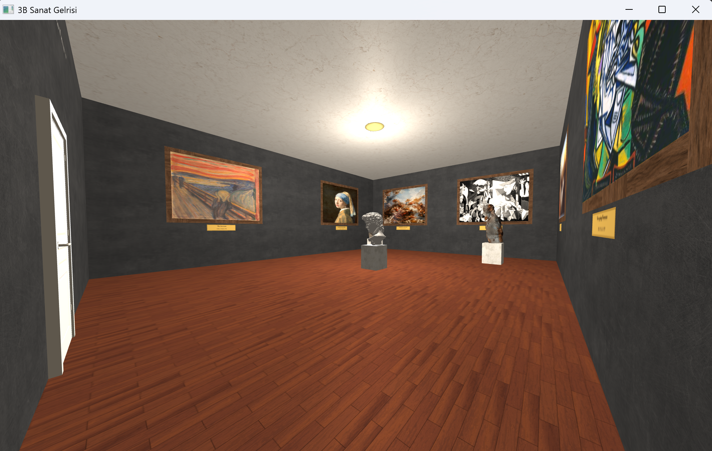
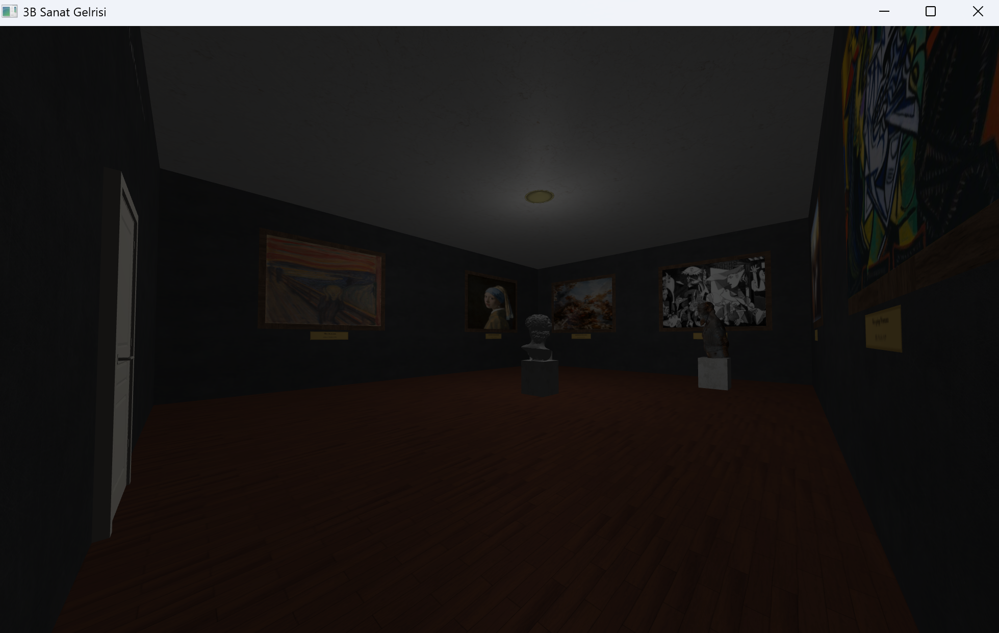
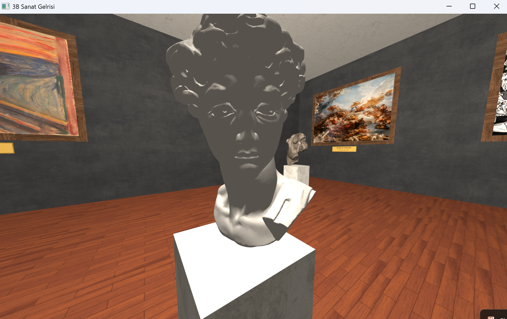
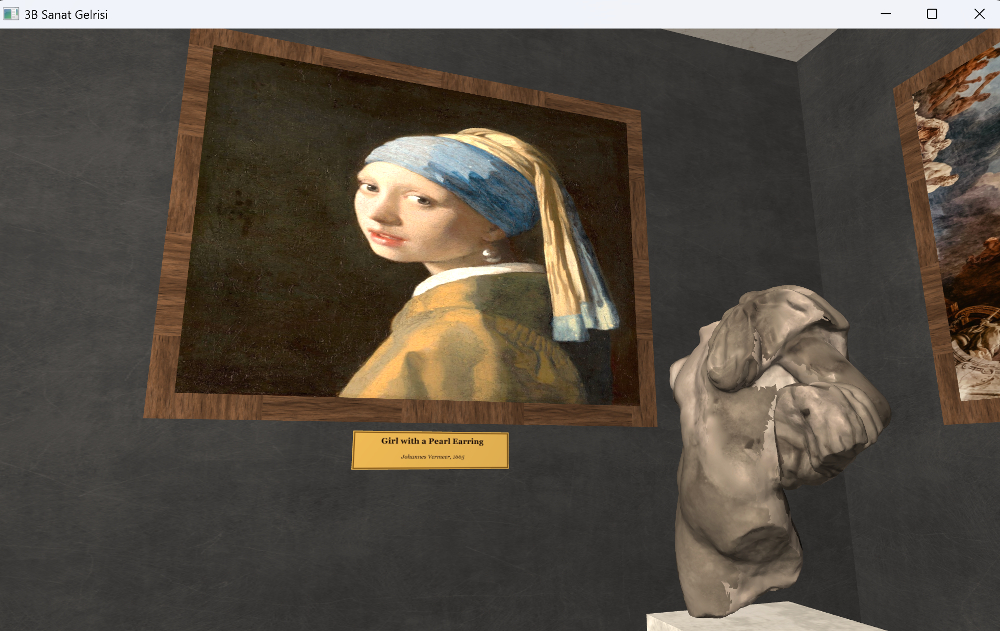

# 🎨 3D Art Gallery

Modern OpenGL kullanılarak geliştirilen interaktif bir 3 boyutlu sanat galerisi simülasyonu.

## 📌 Proje Hakkında

**3D Art Gallery**, C++ ve OpenGL kullanılarak geliştirilmiş interaktif bir sanat galerisi uygulamasıdır. Projede kullanıcı, birinci şahıs kamera sistemi ile galeride serbestçe dolaşabilir, dünyaca ünlü sanat eserlerini inceleyebilir ve gerçekçi ışıklandırma efektleriyle desteklenen üç boyutlu ortamı keşfedebilir.

Uygulama, modern OpenGL (Core Profile) mimarisi kullanılarak geliştirilmiş olup GLAD ve GLFW kütüphaneleri üzerine kurulmuştur.

---

## 📸 Ekran Görüntüleri

<p align="center">
  
</p>

*Galeriden genel bir görünüm ve aydınlatma efektleri:*

<p align="center">
  
  
  
</p>

---

## ✨ Özellikler

### 🎮 Birinci Şahıs Kamera Sistemi

* Galeri içerisinde serbest dolaşım
* Fare ile kamera kontrolü
* Yakınlaştırma/Uzaklaştırma (Zoom)

### 🚧 Çarpışma Algılama (Collision Detection)

* Duvarlardan geçişi engelleyen sınır kontrolleri
* Heykeller için görünmez çarpışma kutuları
* Daha gerçekçi kullanıcı deneyimi

### 💡 Dinamik Işıklandırma

* Açılıp kapatılabilen galeri ışıkları
* Ambient, Diffuse ve Specular aydınlatma hesaplamaları
* Gerçekçi yüzey ve model aydınlatması

### 🖼️ Sanat Eserleri

Galeride çeşitli ünlü sanat eserleri bulunmaktadır:

* **The Scream (Çığlık)** — Edvard Munch
* **Girl with a Pearl Earring (İnci Küpeli Kız)** — Johannes Vermeer
* **Guernica** — Pablo Picasso
* **The Persistence of Memory (Belleğin Azmi)** — Salvador Dalí

Her eserin altında sanatçı ve eser bilgisini gösteren açıklama plakaları yer almaktadır.

### 🗿 3D Modeller

* OBJ formatında yüklenen heykeller
* Kendi ekseni etrafında dönen modeller
* Kapı ve tavan lambası gibi dekoratif detaylar

### 🎨 Doku Kaplama (Texture Mapping)

* Duvar dokuları
* Zemin dokuları
* Tavan dokuları
* Tablo görselleri

---

## 🎮 Kontroller

| Tuş             | İşlev                        |
| --------------- | ---------------------------- |
| **W**           | İleri hareket                |
| **S**           | Geri hareket                 |
| **A**           | Sola hareket                 |
| **D**           | Sağa hareket                 |
| **Mouse**       | Kamerayı yönlendirme         |
| **Mouse Wheel** | Yakınlaştırma / Uzaklaştırma |
| **L**           | Işığı Aç / Kapat             |
| **ESC**         | Uygulamadan çık              |

---

## 🛠️ Kullanılan Teknolojiler

* C++
* OpenGL 3.3 Core Profile
* GLFW
* GLAD
* GLM
* stb_image

---

## 📂 Proje Yapısı

```text
3D-Art-Gallery/
│
├── assets/
│   ├── models/
│   └── textures/
│
├── shaders/
│   ├── vertexShader.vert
│   └── fragmentShader.frag
│
├── include/
│
├── lib/
│
├── src/
│   ├── main.cpp
│   ├── Camera.cpp
│   ├── Shader.cpp
│   ├── Model.cpp
│   └── Room.cpp
│
└── README.md
```

---

## ⚙️ Gereksinimler

Projeyi çalıştırabilmek için:

* Visual Studio 2022 (önerilen)
* OpenGL destekli ekran kartı
* C++17 veya üzeri
* GLFW
* GLAD
* GLM

---

## 🚀 Kurulum

### Visual Studio ile Çalıştırma

1. Projeyi klonlayın:

```bash
git clone https://github.com/kullaniciadi/3D-Art-Gallery.git
```

2. Visual Studio ile proje dosyasını açın.

3. `include` ve `lib` dizinlerinin doğru şekilde tanımlandığından emin olun.

4. Projeyi derleyin:

```bash
Build → Build Solution
```

5. Uygulamayı çalıştırın.

---

## 🎯 Ders Kapsamı

Bu proje, **Bilgisayar Grafikleri** dersi dönem projesi kapsamında geliştirilmiştir.

Projede aşağıdaki bilgisayar grafikleri kavramları uygulanmıştır:

* 3D Modelleme
* Texture Mapping
* Camera Systems
* Lighting Models
* Collision Detection
* Shader Programming
* Object Transformations
